# FightZone – Karate Kumite Scoreboard

## 1. Project Description

FightZone is an Android mobile application developed to manage Karate Kumite practice matches and display scores in real time.

The application allows users to control match timers, manage competitor scores, record warnings, track Senshu, determine winners, and save fight results. It also provides access to an online scoreboard that can display live match information on a laptop, television, monitor, or projector.

This project is designed to make karate practice matches easier to manage, improve score visibility, and help players and referees follow match progress.

## 2. Main Features

### Welcome Screen
- Introduces the FightZone application.
- Provides access to the main menu.

### New Fight
- Enter the names of AKA and AO competitors.
- Start, stop, and reset the match timer.
- Record points for both competitors.
- Manage Senshu and warnings.
- Determine the winner based on the fight result.
- Save completed fight results.

### Fight History
- View previously completed matches.
- Review competitor names, scores, winners, reasons, and dates.
- Delete saved fight records.
- Share fight results.

### Live Display
- Open the online scoreboard.
- Share the live scoreboard link.
- Copy the scoreboard link for use on another device.

### Settings
- Customize the match duration.
- Configure the winning point gap.
- Save settings for future matches.

### Real-Time Web Scoreboard
- Displays the current competitor names and scores.
- Shows the match timer and winning point gap.
- Displays Senshu, warnings, and match status.
- Updates automatically when the current fight data changes in Firebase.
- Can be displayed on a larger screen using a web browser.

## 3. Technologies Used

| Technology | Purpose |
|---|---|
| Java | Android application development |
| XML | Android user interface design |
| Android Studio | Development environment |
| Firebase Cloud Firestore | Store fight history and synchronize live fight data |
| Firebase Hosting | Host the online scoreboard |
| HTML | Structure the scoreboard webpage |
| CSS | Style the scoreboard webpage |
| JavaScript | Receive live updates and update the webpage |
| SharedPreferences | Store timer and winning-gap settings |

## 4. Project Structure

The Android Studio project is organized as follows:

```text
TimerAndFight/
│
├── app/
│   ├── src/
│   │   ├── main/
│   │   │   ├── java/
│   │   │   │   └── com/example/timerandfight/
│   │   │   │       ├── WelcomeScreen.java
│   │   │   │       ├── MainActivity.java
│   │   │   │       ├── NewFightActivity.java
│   │   │   │       ├── HistoryActivity.java
│   │   │   │       ├── HistoryAdapter.java
│   │   │   │       ├── FightRecord.java
│   │   │   │       ├── ShareResultActivity.java
│   │   │   │       ├── LiveDisplayActivity.java
│   │   │   │       └── SettingsActivity.java
│   │   │   │
│   │   │   ├── res/
│   │   │   │   ├── drawable/
│   │   │   │   ├── layout/
│   │   │   │   └── mipmap-*/
│   │   │   │
│   │   │   └── AndroidManifest.xml
│   │   │
│   │   ├── androidTest/
│   │   └── test/
│   │
│   ├── build.gradle.kts
│   ├── google-services.json
│   └── proguard-rules.pro
│
├── build.gradle.kts
├── gradle.properties
├── gradlew
├── gradlew.bat
├── local.properties
├── settings.gradle.kts
└── README.md
```

*Note: The structure above highlights the main files. Some folders and files may differ depending on the project configuration.*

## 5. Firebase Integration

FightZone uses Firebase Cloud Firestore to store and synchronize fight information.

### Fight History

The `fights` collection stores completed fight records, including competitor names, scores, winner, result reason, and date/time.

The Android application retrieves these records and displays them in the Fight History screen.

### Live Fight Data

The `liveFights/current` document stores the current fight information, including:

- AKA and AO competitor names.
- Competitor scores.
- Remaining timer.
- Senshu status.
- Warnings.
- Fight status and winner information.

The Android application updates this document during a fight.

### Live Web Scoreboard

The web scoreboard connects to the same Firebase project. It uses Firestore's real-time listener to detect changes to `liveFights/current`.

When the Android application updates the score or timer, the webpage receives the updated data and refreshes the displayed information automatically.

The Android application and webpage communicate through Firebase rather than connecting directly to each other.

## 6. Application Workflow

1. Launch FightZone.
2. Tap **START FREE** to enter the main menu.
3. Select **New Fight**.
4. Enter the competitor names.
5. Start the timer and control the scores, Senshu, and warnings.
6. Open the live scoreboard on another device when required.
7. Finish the match and save the result.
8. Open **Fight History** to review, share, or delete saved results.
9. Open **Settings** to change the match duration and winning point gap.

## 7. Running the Android Application

1. Open the `TimerAndFight` project in Android Studio.
2. Allow Gradle synchronization to complete.
3. Ensure the Firebase configuration file is available.
4. Connect an Android device or start an emulator.
5. Run the application from Android Studio.

A generated APK can also be installed on a compatible Android device.

## 8. Live Scoreboard Website

The web scoreboard is maintained in a separate folder named `KumiteLiveScoreboard`, rather than inside the Android project structure shown above.

Its main files are:

```text
KumiteLiveScoreboard/
├── index.html
├── style.css
├── app.js
├── firebase.json
└── .firebaserc
```

- `index.html` defines the scoreboard structure.
- `style.css` controls the scoreboard appearance.
- `app.js` connects to Firebase and updates the scoreboard in real time.
- `firebase.json` contains Firebase Hosting configuration.
- `.firebaserc` identifies the Firebase project used by the Hosting setup.

The website is deployed through Firebase Hosting and can be opened using its hosted URL.

## 9. Advantages

- Provides mobile-based control of karate practice matches.
- Combines scoring, timer, warnings, Senshu, and fight history.
- Supports a live scoreboard on a larger display.
- Allows the referee to control the fight from a mobile phone.
- Makes match information visible to competitors and spectators.
- Stores completed results for later review.
- Supports configurable match duration and winning point gap.
- Can be used in university karate clubs, schools, training sessions, and practice tournaments.

## 10. Conclusion

FightZone combines an Android scoring application with Firebase Cloud Firestore and a web-based scoreboard to provide a convenient solution for Karate Kumite practice matches.

The application helps manage match information from a mobile phone while allowing competitors and spectators to view live scores on a larger screen.

**Project Name:** FightZone – Karate Kumite Scoreboard  
**Platform:** Android and Web  
**Academic Purpose:** University Mobile Application Development Project

## 11. Application Screenshots

### Welcome Screen
The welcome screen introduces FightZone with its karate-themed design.

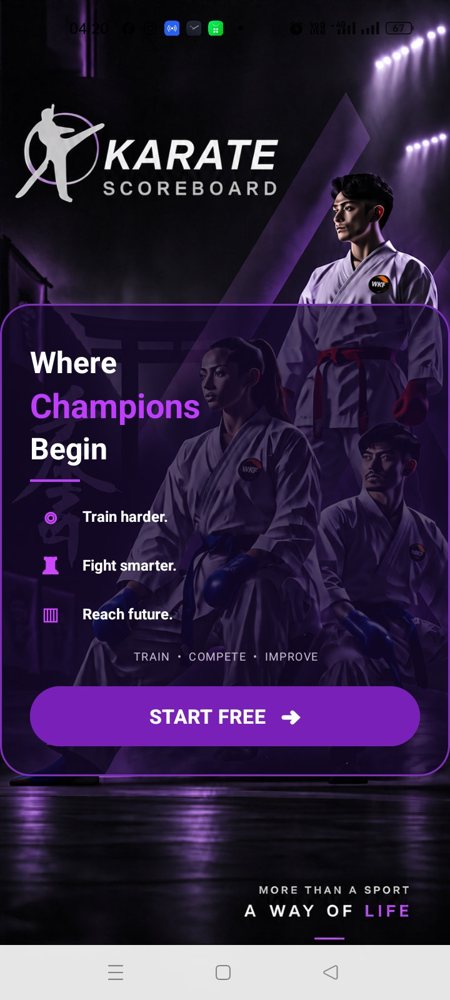

### Main Menu
The main menu provides access to New Fight, Fight History, Live Display, and Settings.

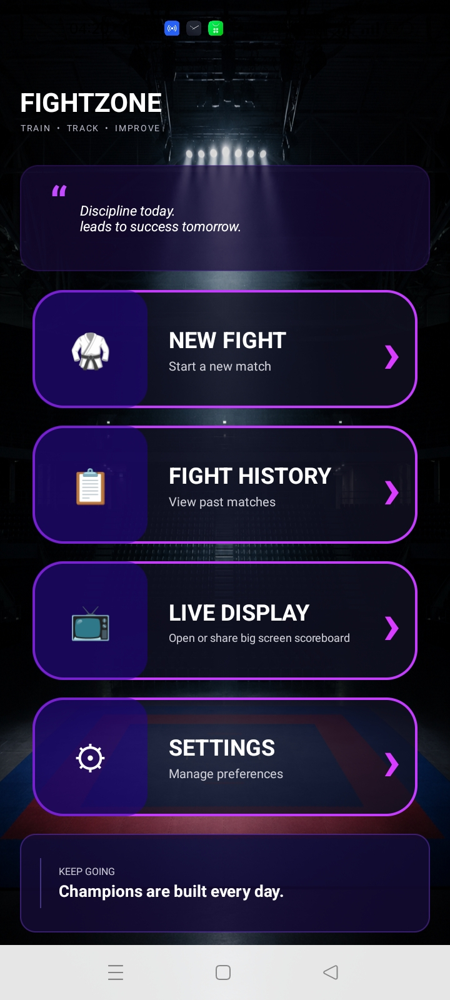

### New Fight – Scoring Interface
The scoring screen allows the referee to control the match timer, award points, and manage Senshu and warnings.

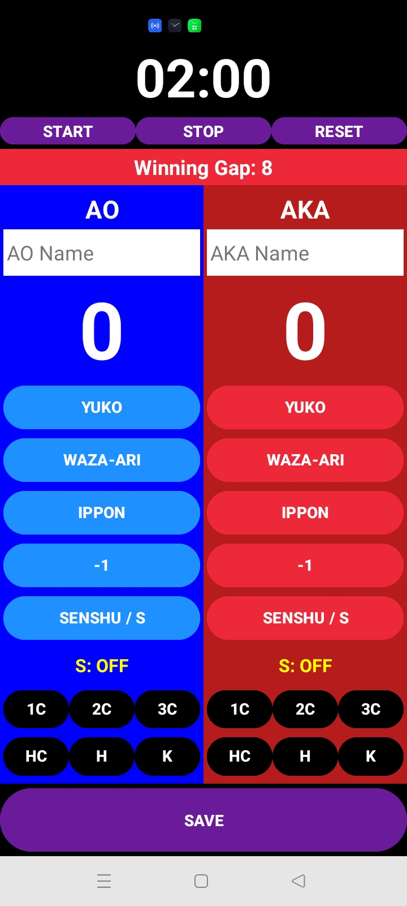

### Selecting a Winner
The application helps manage match results and identify the winner.

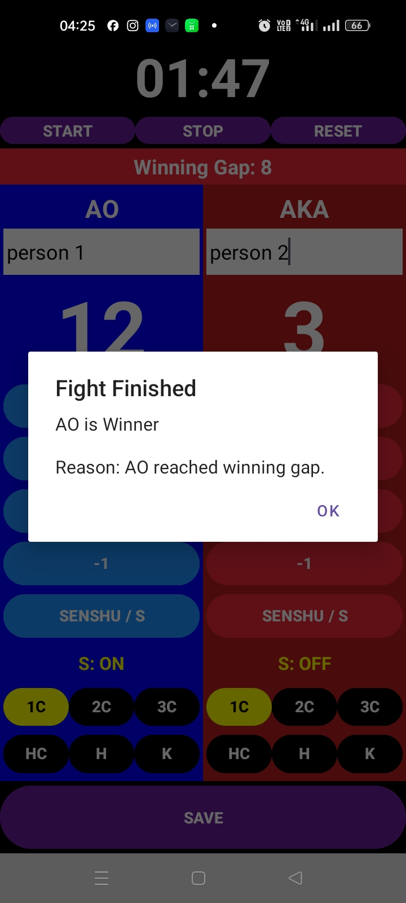

### Fight History
The fight history screen displays completed matches, scores, winners, and match details.

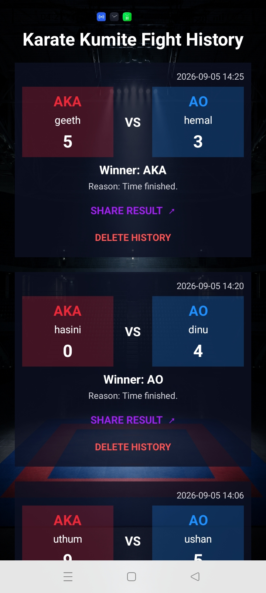

### Delete Fight History
Users can delete saved fight records.

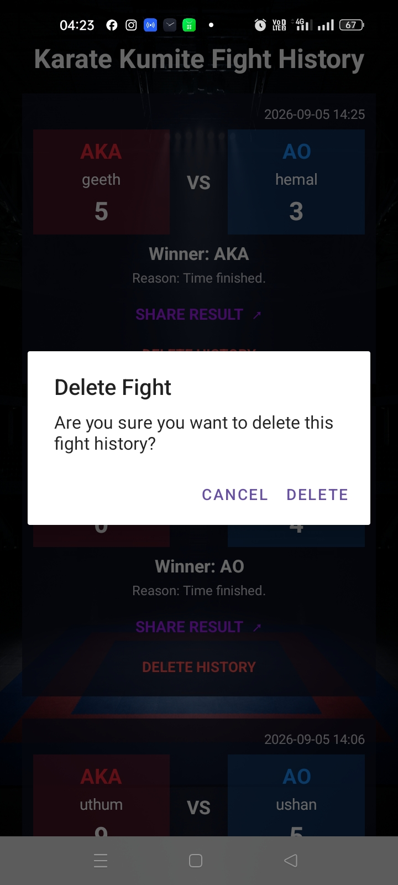

### Share Fight Results
Users can share the results of completed matches.

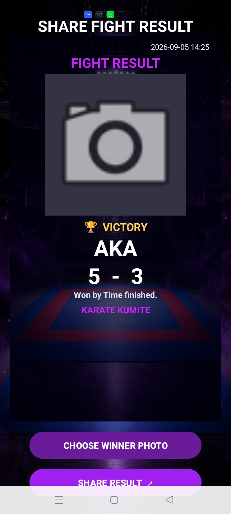
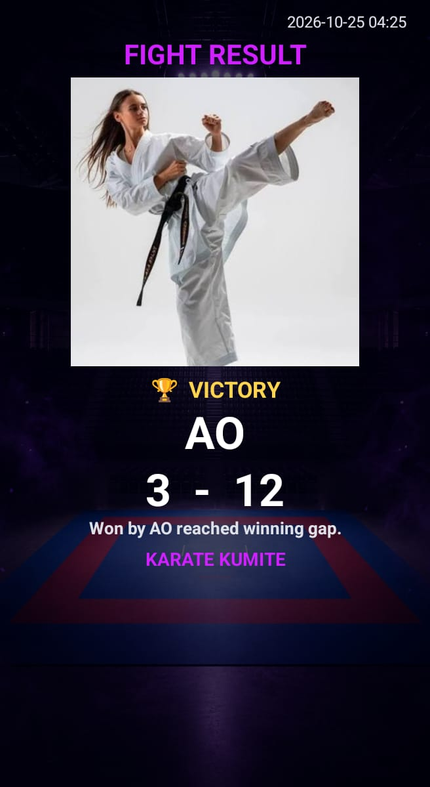
### Live Display
The live display screen provides options to open, share, or copy the online scoreboard link.

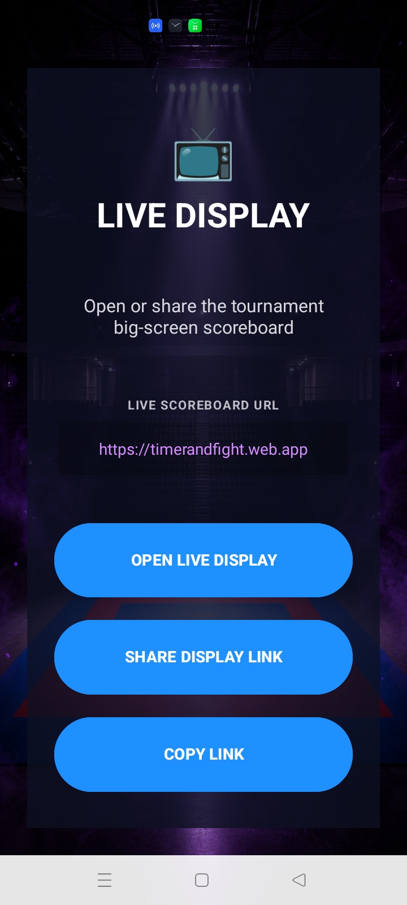

### Scoreboard Settings
Users can customize the match countdown duration and winning point gap.

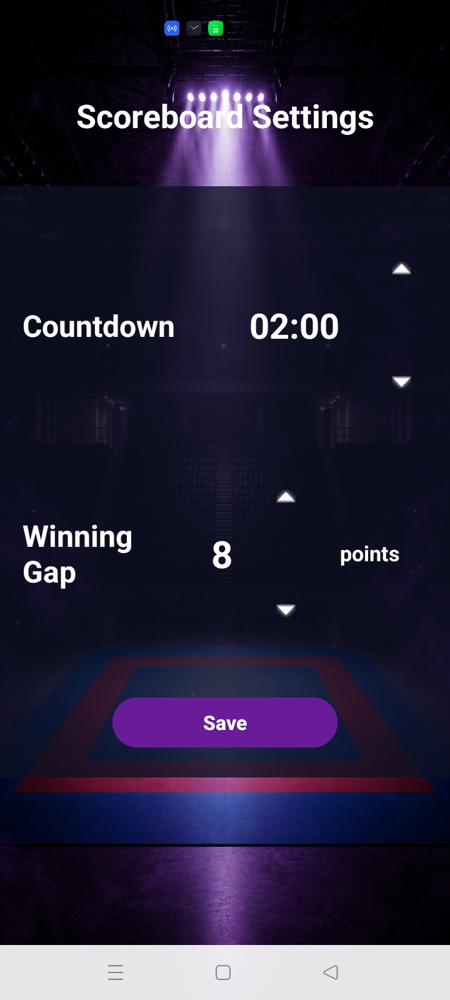

### Real-Time Web Scoreboard
The web scoreboard displays current fight information and receives live updates from Firebase.

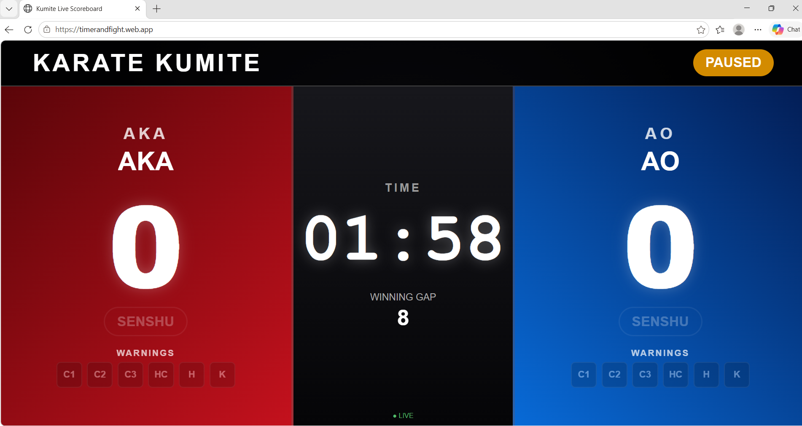

